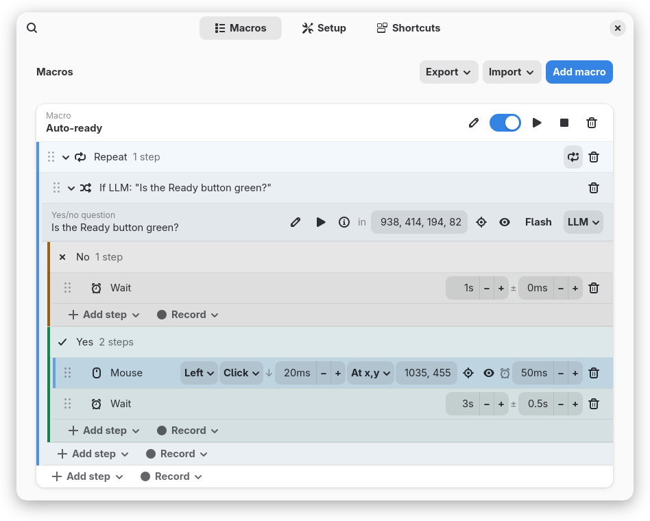
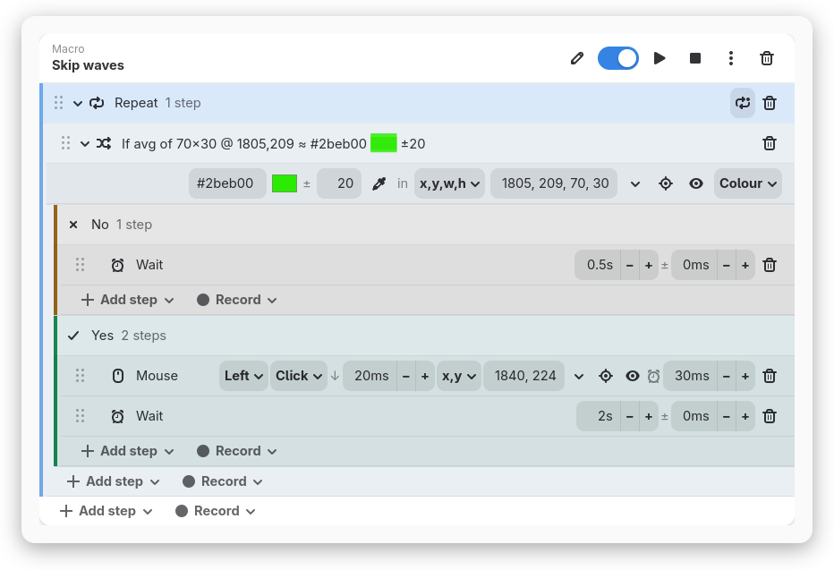
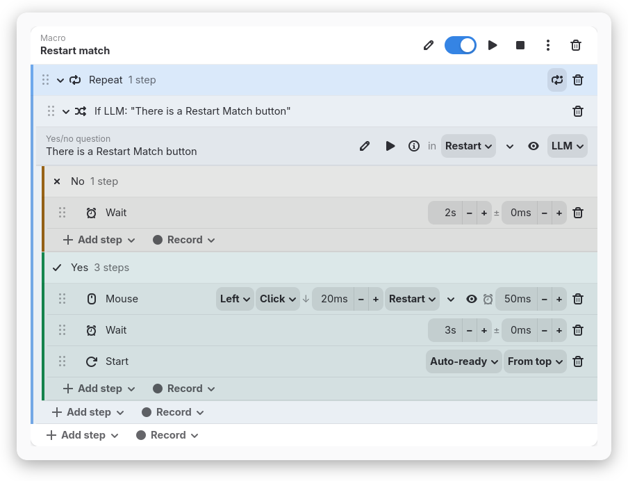
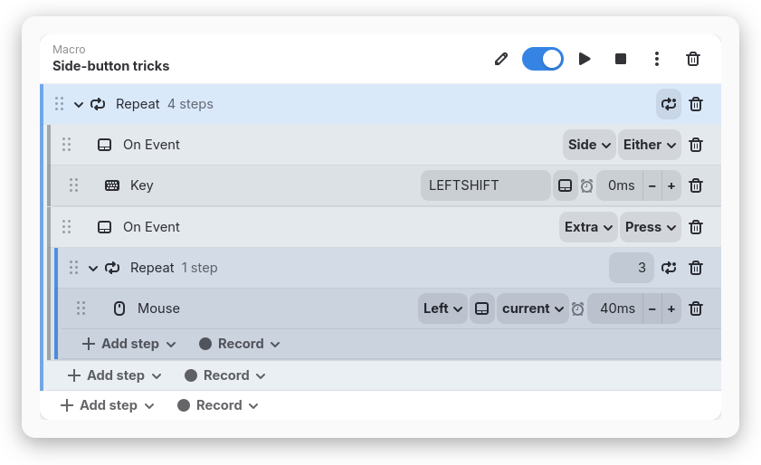
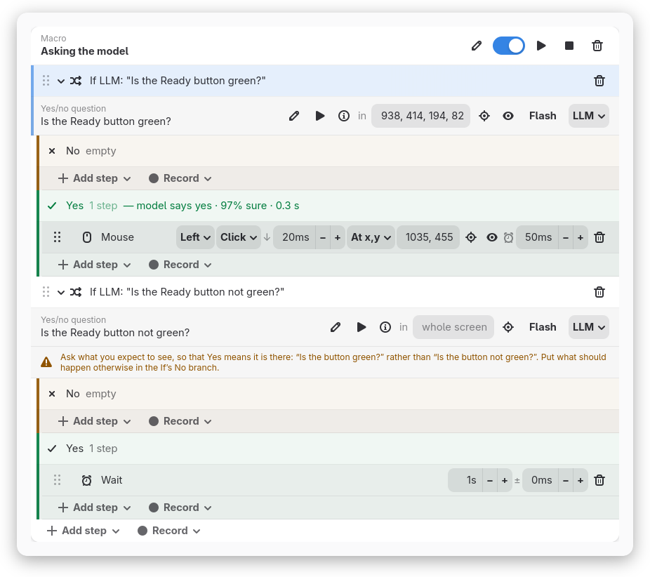
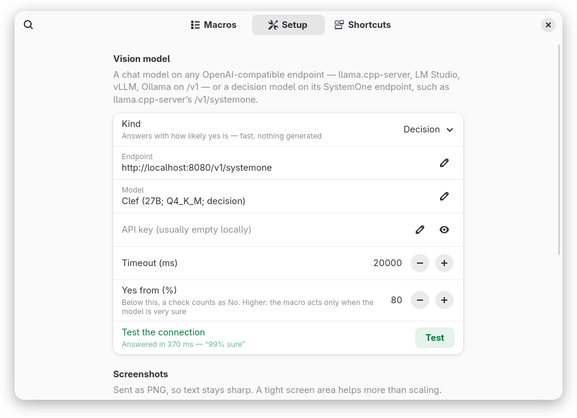
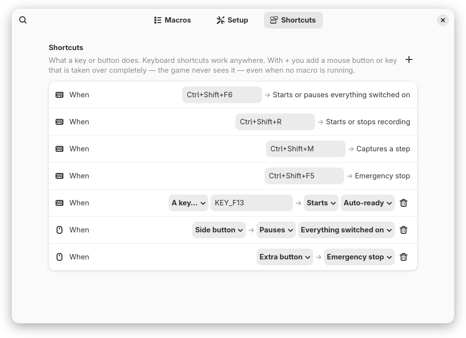

# Macroclickwerk

Record, edit and replay input macros on GNOME/Wayland — with loops, and with
conditions that can look at the screen.



A macro is a tree of steps: clicks, pointer moves, key presses, typed text,
scrolls and waits — and **On Event**, which parks the run until a button or key of
your choosing is pressed (or released) and swallows that press, so a side
button can mean "do the next steps" instead of what it normally does. Around
them go **Repeat** — forever, or a number of times — and **If**, which asks the
screen a question and runs its **Yes** or its **No** block. You leave a Repeat
with **Break** inside an If, which keeps every decision in one place. An If can
ask:

- **a screen colour** — "the pixel at 840,512 is green ±24", or "this 70×30
  area averages to green ±20". A few milliseconds, deterministic, no network.
- **a vision model** — a screenshot plus a yes/no question of your own ("Is the
  Ready button green?"). Either a chat model on any OpenAI-compatible endpoint,
  or a *decision* model that answers with how likely yes is, in a third of a
  second.
- **all of / any of / not** over the above, and **always** / **never** for a
  branch that is not deciding anything today.

Every step is one line in the editor, and everything about it is on that line.

## What you can do with it

### Wait for a button, then click it

The screenshot above is the macro this was built for. A Repeat asks the model,
once a second, whether the Ready button is green; when it is, the Mouse step
clicks it and waits three seconds, give or take half a second. The question
looks at **Ready** — a named area, the button's rectangle under a name — so the
model looks at the button and not at the whole screen, and a green outline
flashes over that area every time the check runs, so you can watch it look
where you meant. The click is aimed at **Ready** too, which for a click is the
middle of the area. The macro lives in the *Tower defense* collection, a file
of its own. On the click,
**↓ 20ms** is how long the button is held down, and **⏰ 50ms** is the game's
turn: the next step waits until the game has had a frame to register the click.

### Skip waves on a colour, with no model at all



When the answer is a colour, a colour check is faster and never wrong about
it. **Pick** (⌖) takes a click as one pixel or a drag as an area, and brings
back the colour that area averages to; 💧 reads it again in place when the
button has changed shade. The swatch beside `#2beb00` follows what you type, so
you always see which green you mean.

### Macros that drive each other



A **Start** step starts another macro — or restarts it, if it is already going
— from the top or from any step you pick. Here a watcher notices the round is
over, clicks **Restart Match**, and hands over to Auto-ready from the top. A
**Stop** step ends one. Switch several macros on and **Run** starts them
together, taking turns: one acts until it reaches a Wait or comes round a
Repeat, and the other gets its go then.

### Side-button tricks: hold to sprint, three-shot burst



An **On Event** holds the steps after it, drawn as a block. A key or click
under an On Event can *follow* it — the toggle next to the key — so it goes down when you
press the side button and comes up when you let go: hold to sprint, without the
game ever seeing the side button. The second On Event waits for the extra button
and fires three clicks, 40 ms apart.

### Ask the model the right question



A model can only say yes or no, so the question has to be one that yes or no
answers — and it works best when **Yes means what you are waiting for is on
the screen**: the click goes in Yes, waiting or trying again in No. The editor
checks the wording as you type. "What colour is the button?", "Count the
enemies" and "Is the button not green?" each get a hint underneath saying what
to ask instead. **▶ Check now** asks the model about the real screen right
away and marks the branch the If would take — "Yes — model says yes · 97% sure ·
0.3 s" — so you can try a question before a macro relies on it.

### A decision model, in a third of a second



Under **Settings → Setup**, **Kind** is either **Chat** — any OpenAI-compatible
chat endpoint, asked for a one-line JSON verdict — or **Decision**: a decision
model such as Cloudflare's Clef on llama.cpp-server's `/v1/systemone`, asked one
yes/no question and answering with a probability, with nothing generated. On
the same machine and the same 27B size, a decision took about 0.3 s where a
chat model took 1–2 s. **Yes from (%)** sets how sure it must be: below
that the answer is No, so raising it makes a macro act only when the model is
very sure. **Test** sends one small picture and says what came back.

### Shortcuts: keys and spare buttons



**Settings → Shortcuts** is one list of what a key or button does. The keyboard
shortcuts come first — `Ctrl+Shift+F6` starts or pauses everything switched on,
`Ctrl+Shift+F5` is the emergency stop — and work anywhere. With **+** you add a
spare mouse button or key that is taken over completely, so the game never sees
it: it can start, pause or stop a macro, or everything switched on, even when
none is running; start or stop recording; capture a step; or stop everything.
Until you pick what it does, its button works as usual, and so does every
button whenever Macroclickwerk is not running. To make a button press something
else inside a game, use an On Event step in a macro, as in the side-button
tricks above. While a macro is waiting on a button in an On Event, that press
goes to the On Event, not to the shortcut list.

## Features

- **Recording** of real mouse and keyboard input, coalesced into readable steps:
  clicks carry their absolute screen position, pointer movement becomes a Move
  wherever it comes to rest, and idle gaps become waits. Record into any row —
  into the middle of a loop, say — and watch that row go red while it runs.
- **A one-line-per-step editor** — every setting of a step on its own line;
  macros, Repeat and If fold from the arrow on their left; steps move by
  dragging the grip, macros by the ↑ ↓ on their line. Times step with − and +; every number field with ↑/↓, or the scroll
  wheel once focused.
- **A wait after any action** — the ⏰ time on a click, move, key, text or
  scroll gives the game a frame to register it before the next step.
- **Two kinds of vision model** — a chat model on any OpenAI-compatible
  endpoint, or a decision model that answers with a probability in a third of a
  second; a **Yes from (%)** bar for how sure it must be.
- **Questions you can trust** — the wording is checked as you type, and
  **▶ Check now** asks the model about the real screen and marks the branch the
  If would take.
- **Shortcuts for keys and spare buttons** — keyboard shortcuts, and mouse
  buttons or keys taken over to start, pause or stop macros, record, capture or
  stop everything, even when no macro is running.
- **Pause and continue** — halting a run remembers the step it was on, and
  clicking a row is what says where the next run starts.
- **See what a check is looking at** — the checked area is outlined for a
  second every time it runs, drawn just after the screen is read, so it is
  never part of what was measured.
- **A panel popup that stays out of the way** — a switch, a stop, what is
  running, and a way into the settings.
- **Emergency stop** that aborts mid-macro and releases every held key; a
  stopped or paused macro also lets go of whatever it was holding down.
- **Named points and areas** — give a spot or a rectangle on the screen a
  name, and everything aimed at it says the name instead of the numbers; other
  steps and checks pick it from a list, a click at an area goes to its middle,
  and picking the place again moves everything aimed at it.
- **Collections** — keep macros in files of their own, one per game, saved
  and loaded alongside the rest, and switched on and off as one; a ⋯ on each
  macro moves or copies it into one.
- **Backup** — **Export** and **Import** next to **Add macro**, for the macros
  and for the settings, to a file you choose.

## How it fits together

| Piece | Role |
|---|---|
| `macroclickwerk.c` | Root daemon. Grabs the real input devices, mirrors them to uinput clones, injects event trains on request, and streams observed events while recording. Always forwards real input, and only holds a grab while something is reading the clone. **No macro logic.** |
| `gnome-shell/` | The extension. Owns the macro model, the editor UI, all control flow, screenshots and the model calls. |

The split is deliberate: the daemon is the only thing that can see and synthesise
input below the compositor, and the shell is the only thing that knows where the
pointer actually is and can screenshot without a portal prompt. Because the
extension sends one step at a time, stopping a macro is immediate.

### Absolute positioning

A move to a fixed coordinate is atomic: the extension asks the compositor's own
seat to warp the pointer there — one call, exact position, no acceleration
curve involved — and verifies with `global.get_pointer()`. There is no visible
glide and nothing to configure; mouse settings are never touched.

Arriving and being *seen* to arrive are not the same thing, so a positioned
click waits 50 ms after the move before the button goes down. The compositor
moves the pointer immediately; an application under it learns where the pointer
now is on its own schedule, which for anything drawing frames is once a frame.
Press in the same millisecond as the warp and a game still holds the position
from before it — so the thing being dragged, aimed or placed goes where the
pointer *was*, which reads as the click landing in the wrong place while every
coordinate involved is correct. A person moving a mouse and clicking never gets
close to being that quick. The wait is skipped when the pointer was already
there, so a macro clicking the same button in a loop pays it once.

What comes *after* a step is yours to set: the ⏰ time on a click, move, key,
text or scroll holds the next step back until the game has had a frame or two
to register this one. A click or a key press also has a **↓** time, how long it
is held down, so the game sees it go down and come back up as two moments. A game reads input once a frame; two actions in the same
millisecond can both land before it looks, and it sees only the last.

If a target swallows the warp (a pointer-confining grab), the extension falls
back to walking there over uinput: nudge, re-read the pointer, nudge again
until it is within a pixel. The move and the click that follows it hold the
daemon between them (`DaemonClient.exclusive`), so no other macro plays in the
middle of a measurement — the pointer being read back has to be the one the
move placed.

If the target application grabs the pointer entirely — a game with mouse-look —
the reported position never changes and absolute moves cannot land. The status
line says so rather than silently clicking the wrong place. Use `move` steps with
a relative offset for those.

## Requirements

- Linux with `uinput`, GCC, `libjson-c`, `libmicrohttpd`
- GNOME Shell 51 on Wayland
- optional: a vision model for model checks — a chat model on any
  OpenAI-compatible endpoint, or a decision model on a SystemOne endpoint

## Installation

```bash
./deploy.sh
```

Rebuilds and installs the daemon, rebuilds the extension, and prints what the
daemon captured. Run it as yourself — it asks for sudo only for the daemon. Then
log out and back in.

### Upgrading from Clickmate

Macroclickwerk is the project formerly named Clickmate, and the rename runs
through every identifier — service, sockets, extension UUID, settings schema —
so an old installation is a separate thing, to be removed once:

```bash
sudo systemctl disable --now clickmate
sudo rm -f /usr/local/bin/clickmate /etc/systemd/system/clickmate.service \
    /usr/lib/systemd/system-sleep/clickmate
rm -rf ~/.local/share/gnome-shell/extensions/clickmate@tbocek.github.com
```

Macros live under the settings schema, so they do not carry over on their own:
**before** removing the old extension, export them (Settings → Macros →
Export → Macros) and import the file into Macroclickwerk — the same round trip
works for settings.

The two halves separately:

### Daemon

```bash
make
sudo make install
```

`macroclickwerk.service` runs the daemon with `-a`: every keyboard and pointer is
captured automatically, so the installation works on any machine without
editing anything. A device another process holds exclusively — a key remapper's
real keyboard, say — is left to it, and the remapper's virtual output is
captured instead, which keeps recorded keystrokes matching the letters you
actually press.

To capture only specific devices instead, replace `-a` with `-n` lines:

```bash
grep '^N: Name' /proc/bus/input/devices
```

lists the names. Names rather than paths, because anything paired through a
wireless receiver gets no entry under `/dev/input/by-id` at all, and bare
`/dev/input/eventN` numbers move around between boots. `-d PATH` still works if
you prefer it. A name that matches nothing is only a warning, so an unplugged
device does not stop the rest from being captured. With a remapper in the
chain, naming devices is the safer choice — the service file shows a worked
example.

**Whatever you record from must be captured.** A keyboard-with-touchpad and a
separate mouse are two devices; with `-a` both are picked up, but if you switch
to naming devices and leave the mouse out, the daemon never sees it and nothing
it does is recorded or observed.

Devices do not have to exist when the daemon starts. `/dev/input` is watched, so
anything matching is captured when it appears and reattached when it comes back
after being unplugged. That matters more than it sounds: a wireless mouse often
pairs a second or two into boot, and a remapper upstream of macroclickwerk rebuilds
its virtual keyboard every time it is restarted, and both are picked up again
on their own. `journalctl -u macroclickwerk -f` shows `captured`, `reattached`
and `detached` as they happen.

The daemon takes an exclusive grab on those devices — but only while something
else is actually reading the clone, which it checks once a second. Usually that
costs one `readlink` per device, against the exact descriptor the reader was
found on last time; only when a clone has no reader does it walk `/proc/*/fd`
looking for one, which is at startup and after a session ends. Grabbing
reroutes a device through this
process, so it never happens on faith: at boot, before any compositor is up,
nothing is grabbed and input flows directly; when the session's compositor
picks the clones up, the grabs engage; when it goes away, they let go. A
forward that fails releases its grab on the spot, and after three such
failures the device stays observe-only until it reattaches — real input
flowing twice for a moment is an annoyance, real input flowing nowhere is a
dead keyboard. The kernel also drops every grab when the process dies, so a
crash self-heals. While changing the C code, still run it from an **SSH
session or a second TTY** and wrap it in `timeout 60`, so a mistake cannot
lock you out of your own keyboard.

Shutdown and sleep are both clean. Stopping the daemon (or shutting the machine
down) releases the grabs, releases anything still held down, and destroys the
virtual devices. `make install` also drops a hook into
`/usr/lib/systemd/system-sleep/`, so just before the machine suspends, whatever
is playing is aborted and every held key released — nothing stays pressed, or
keeps playing, across a sleep the desktop never sees. The daemon itself stays
running; devices that re-enumerate on resume are re-captured by its hotplug
watch. (`SIGUSR1` to the daemon is that same stop-and-release, available from
anywhere; the sleep hook is just `systemctl kill -s SIGUSR1 macroclickwerk`.)

### Extension

```bash
cd gnome-shell
pnpm install
pnpm run build
pnpm run install     # symlinks dist/ into ~/.local/share/gnome-shell/extensions
```

Log out and back in (Wayland has no `Alt+F2 r`), then enable *Macroclickwerk*.

### A vision model

Only needed for model checks. Two kinds work, chosen under *Settings → Setup →
Kind*; the endpoint and the model's name are yours to fill in, whatever your
server calls it.

**Chat** — any OpenAI-compatible chat endpoint with a vision model. For
example:

```bash
ollama serve
ollama pull qwen2.5vl:7b
```

then set the endpoint to `http://localhost:11434/v1/chat/completions`. Each
check sends the screenshot and asks for a single JSON object,
`{"match": true|false, "reason": "…"}`, with `response_format: json_object` so
servers that support constrained decoding enforce it (the field is dropped
automatically if the server rejects it). Small models still wander, so the
reply parser also accepts fenced JSON, `"true"` as a string, `1`/`0`, alternate
keys like `answer` or `result`, trailing chatter, and a bare YES/NO. Reasoning
models get `chat_template_kwargs: {enable_thinking: false}`, because a model
that deliberates over every screenshot answers seconds late — or, once its
token budget runs out mid-thought, not at all; thinking that arrives anyway is
dropped rather than read for a verdict.

**Decision** — a decision model on a SystemOne-style endpoint, such as Clef on
llama.cpp-server's `/v1/systemone`. Switching the kind changes the end of the
endpoint between `/chat/completions` and `/systemone` for you. The check is
sent as one yes/no question about the screenshot, and the model answers with
the probability of yes in a single pass — nothing is generated, which is what
makes it fast. **Yes from (%)** is the bar: below it, the answer is No. When the
model is unsure the macro waits, and raising the bar makes it act only when the
model is very sure.

Endpoint, model, timeout and kind are global; a check carries only its
question, its area and whether to flash it. **Test the connection** sends one
small red picture and says what came back — red means no answer and why,
yellow means it answered but did not see the picture, which is usually a model
that cannot see images. Every check uploads a picture of your screen to the
endpoint, so point it at a machine you trust.

If the model cannot be reached or gives no answer, the macro stops — guessing
either branch would send it somewhere on no evidence — and the problem log in
the panel popup says why.

## Usage

| Shortcut | Action |
|---|---|
| `Ctrl+Shift+F5` | Emergency stop |
| `Ctrl+Shift+F6` | Run the macros that are switched on / pause them / continue |
| `Ctrl+Shift+R` | Start / stop recording into the selected macro |
| `Ctrl+Shift+M` | Capture one click or move, appended to the selected macro |

All four can be changed, and spare mouse buttons added, under *Settings →
Shortcuts*.

The panel popup holds only a run switch, a **Stop**, what is running, and a
**Settings** button. It is also where progress shows up: the current step, the
last condition verdict, "Recorded 3 steps". That text is kept after the fact,
because most of it happens while the menu is closed — click the panel icon to
read it. Everything else — macros, steps, conditions, which macros run — lives
in the Settings window.

### Switched on, and running several at once

Each macro has a switch next to its name in the editor, and **Run** starts every
macro that is switched on — all of them, at the same time. They are independent:
each keeps its own place in its own steps, and one finishing or failing does not
touch the others. What they share is the machine, so they take turns at it.

A macro that is **one at a time** — the 🔒 beside its switch, pressed in by
default — takes turns with the others that are. One that has the turn keeps it
until it stands still on purpose: a **Wait** step, an **On Event** waiting for
its button, or a pause — or until it comes round a **Repeat**, which gives the
others a go after every round. Only then does the next one act. The first does
not leave its Wait the moment the time is up: it carries on once no other is
acting, so the other always finishes what it is doing first. Everything else
keeps the turn: the hold of a click, the ⏰ wait after a key, an If asking the
model and then clicking on its answer — so "look, then click" is never cut in
half by another macro clicking somewhere else in between. The price is that a
macro waiting for the turn waits for as long as the other one acts; a long
model check in one holds up the rest.

Wait and Repeat lines carry the same lock, open by default: open, they let the
others go. Close it on a Wait and no other macro acts until the wait is over —
a pause that belongs to what this macro is doing, like letting an animation
finish before the next click. Close it on a Repeat and its rounds go back to
back without letting anyone in between.

A macro with the lock open acts side by side with everything, a step at a time,
neither waiting for the turn nor holding anyone up — for something like a
hold-to-sprint button that must answer at once. A step is still the unit: a
click at a fixed position holds the pointer for the whole move *and* the click
at the end of it, so no other macro can land a nudge in the middle and leave it
clicking somewhere else.

Beside the switch is a **▶** that runs that one macro, on or off, right now —
and turns into **⏸** while it runs, which is also how the editor shows you which
macros are going without your having to look at the panel. The **■** next to it
stops the macro and puts the selection back on its first step.

A macro that is switched off is still yours to edit, record into and step
through; it just does not join in when you press Run.

The macro is the only thing there is a switch for. Steps have none: a step that
is in a macro runs when that macro runs. Something you want out of the way for
now is either deleted or put behind an `if` that says when it applies.

Macros can also drive each other. A `start` step names a macro and starts it; if
that macro is already going it is stopped first and begins again, which is the
whole point — a watcher that notices the screen has gone back to its starting
state can put the macro that works it back at the beginning. A second dropdown
on the same step picks where that new run begins: **From top**, or any step of
the target macro, shown indented the way the editor nests them. A
`start` pointing into its own macro is therefore a jump — stop whatever this
run is doing, continue from the chosen step. A `stop` step names a macro and
ends it. Both offer **This one** as the first choice, so a `start` with
nothing named is "go round again" and a `stop` with nothing named ends the run
it is in, the way a `break` ends a loop. Delete the step a `start` begins at and
it falls back to the top. Delete the macro it names and the step says **Missing
macro** in red until you pick another — running it fails with that message
rather than quietly meaning something else.

### Pause, continue, stop

`Ctrl+Shift+F6` — and the switch in the popup — starts the macros that are
switched on, and halts running ones. With one macro running, halting writes down
the step it was on, so the switch reads **Continue** and the next press picks up
there rather than at the top. Several at once are in several places and there is
only one mark, so rather than be wrong about which, the next press starts them
all from the top. **Stop** in the popup, and the emergency shortcut, throw the
place away too, and so does the ■ beside a macro's name in the editor. That one
stands next to the ▶ whether or not anything is running, because the half of it
that puts the selection back on the first step is worth pressing on its own:
it is how you say "start from the beginning again" to a macro you last ran
halfway through.

You can also choose the step yourself: select it. The selected row is the one
mark the editor has — a recording lands there, and a run starts there — so
picking up in the middle of a macro is the same gesture as recording into the
middle of one. There is one selection across the whole page, in whichever macro
you last clicked; that macro is the one recordings go into, and the one that
starts at the selected step. Only a step counts for running; selecting a body,
or the end of a macro, starts at the top, and so do the other macros. A run that
fails selects the step that failed, so you can fix it and press the shortcut
again instead of replaying everything before it, and a run that reaches the end
puts the selection back at the end of its own macro.

The mark is taken at face value: continuing into the `then` or `else` of a
condition runs that branch without asking the condition again, since asking
could send the run down the other one and skip the very step you picked. A loop
you continue into is only shortened for that one pass — the next time round it
runs its whole body.

Separately from all this, while a macro is running, opening the menu and putting
the pointer on it holds the run between steps — otherwise a macro clicking at
fixed coordinates could click its own menu. It carries on as soon as you move
off the menu or close it.

Build a macro by recording it (`Ctrl+Shift+R`), then open Settings to adjust it.
Recorded steps go on the row you selected. Click any row in any macro and it is
tinted blue to show it: a step, and the recording is dropped in right after it;
the **+ Add step** row inside a Repeat, or a **Yes** or **No** header, and the
recording goes at the end of that body. Having selected nothing, the first step
of the macro is selected for you, which is where a run would start anyway; a
macro with no steps yet has only its add row to select. Choose the body of a
loop and a recording lands inside the loop instead of after it — which is what
you want in a macro that is one endless loop. Appending to the end of a macro
that never gets there still tells you so; a body has no such trap.

While a recording is running, the selected row turns a stronger red, so you can
see where the next click will land without looking at the panel.

Recording always resumes from wherever the macro already leaves the pointer.
Between two sessions the mouse gets used for other things, and moving it back to
that spot is not a step worth keeping, so it is not recorded. Anywhere else is,
at its true screen position — coordinates are never shifted.

An `if` draws its **No** block above its **Yes** block. The failure case is the
one you go looking for — the branch that says what happens when the screen is not
what you hoped — and putting it first means it is not buried under a `then` that
has grown. It changes nothing about the run: the condition is still asked once
and the matching branch still runs.

Every list of steps ends in a short row with two buttons. **+ Add step**
offers every kind of step and adds it there, at the end of that list — the row
is the last one because that is where what it adds appears. A new Repeat or If
starts open, so the row for adding into it is right there. **● Record** offers
two ways in. **One step** captures a single action, which is the quickest way to
fill in coordinates: the window gets out of the way, and the next click you make
becomes a Mouse step at that position; move the pointer and hold still for
about a second instead and you get a Move step. **Multiple steps** starts a
whole recording landing at that same row — the window stays out of the way
until you stop (`Ctrl+Shift+R`, the panel menu, or picking **Multiple steps**
again). `Ctrl+Shift+M` captures one step without opening Settings, into
whichever row is selected.

**Right-click any step** for **Run from here**: the macro starts at that step
and carries on from it, which is how you try the second half of something
without sitting through the first. Running from here moves the selection here
too, so the mark, the highlight and where a pause would continue from all
agree. A step that is one action — Mouse, Move, Key, Text, Scroll, Wait — also
offers **Run this step only**: the window drops out of the way, the step runs on
the real screen, and the window comes back. It is the quickest way to check that
a click really lands where you meant it to.

Steps move by dragging the grip on their left. Drop on the top half of a row to
put the step before it, the bottom half to put it after; drop on a Repeat or
On Event header to put it first inside, and hover over a folded Repeat to spring it
open. A step moves with everything inside it. Repeat and If fold from the arrow
on their left; the rest of the header is for selecting, like any other row.

A macro folds the same way, from the arrow left of its name, down to its one
line — which then says how many steps it holds — and stays folded the next
time the window opens. The **↑** and **↓** on that line move the macro up and
down the list, greyed out at either end.

Coordinates are single fields — `100, 200` for a point, `10, 20, 40, 40` for an
area — sized to what is in them. Beside each, **⌖ Pick** fills the field by
pointing: the window gets out of the way, the screen dims, and where you click
lands in the field — which is how you correct a coordinate that has moved
without recording the step again. Escape leaves the field as it was, and what
was picked is flashed back at you. **👁 Show** flashes a red X (or an outline)
at that spot on the real screen for a couple of seconds, so you can check a
number without running anything. An area is picked by dragging one out on the
same overlay, described with the condition it belongs to below.

Every one of these — the picker, the red X, the green flash — is drawn above
*everything*, fullscreen windows included. That is worth stating because it is
where the interesting applications are, and getting it takes two separate
things. A game running fullscreen sits in the shell's top window group, above
ordinary desktop chrome, so anything drawn the ordinary way is drawn behind it.
And a fullscreen window that has a monitor to itself is handed straight to the
display with no compositing pass at all, so even something stacked above it is
not drawn — the compositor has to be asked to keep compositing for as long as
the marker is up, which is what the shell's own on-screen chrome does.

Picking a position asks the compositor for the click rather than asking where
the pointer is, for the same reason: an application that holds the pointer —
any game with mouse-look — has frozen it somewhere of its own choosing, and the
picker takes the grab back before asking. A macro that *runs* has no such
luxury: it has to drive the real pointer to the coordinate, so a step aimed at
a fixed position fails outright against a game that has the pointer locked
rather than clicking wherever it got stuck. Relative motion still works there,
because relative motion is exactly what a locked pointer accepts.

Where a click or a move goes is a dropdown on its line. A Mouse step acts at
**x,y** or at the **current** position of the pointer, and the numbers go away
with it. A Move goes to **x,y** or by an **offset** — the numbers stay but stop
being a place, so **Pick** and **Show**, which are about a spot on the screen,
go instead.

The **▾** after a spot names it: type a name — "Ready", "Shop" — and press
**OK** or Enter. The name belongs to the spot, not to the step, so every click
or move aimed at those exact coordinates shows the name in its dropdown instead
of the numbers, and every other one lists it next to x,y to pick. Choosing
**x,y** on a named step shows its numbers again, to change them; a step moved
off the spot stops showing the name. The target in the same popup moves the
point: click the new spot on the screen, and every step aimed at it moves there
too — when a button moves, one pick fixes every macro that clicks it. The trash
forgets the name, and the steps keep their coordinates.

An area — the rectangle a model check or a colour check looks at — is named the
same way, with the **▾** after its numbers. Every check over exactly that
rectangle shows the name, and once there are named areas, a dropdown before the
numbers offers them, with **x,y,w,h** to see the numbers again. A click or move
can be aimed at a named area too: it lists them with the points, and goes to
the middle of the rectangle. Picking a named area again — dragging a new
rectangle, from a check over it — moves the checks over it and the clicks at
its middle along with it; on a click, the crosshair is greyed out for an area,
since a click picks a point. A name means one place, point or area.

A model check is one line: the yes/no question, then its area — `x, y, width,
height`, or empty for the whole screen. **Pick** drops the window out of the way
and lets you drag a rectangle over the screen, and whatever you drag out is
flashed back at you once the window returns, so the numbers in the field never
have to be taken on trust.

Ask so that Yes means what you are waiting for is on the screen, and put what
should happen then in the If's **Yes** block. A question that yes or no cannot
answer — "What colour…", "Count…", "…green or red?" — or one that asks about
something missing gets a hint under it, with what to ask instead; **ⓘ** beside
the question has the rules, examples, and exactly what is sent to the model.
**▶ Check now** asks the model about the screen as it is, before a macro relies
on the question: the answer goes on the branch the If would take — "Yes — model
says yes · 97% sure · 0.3 s" — and changing the question clears it. A question
inside **all of** or **any of** decides no branch on its own, so its answer shows
under it instead, and so does a check that got no answer, with why.

A colour condition's **Pick** is the same overlay, and it brings the colour
back with it: click a pixel and the check is that pixel and the colour it has;
drag a rectangle and the check is that area and what it averages to.

The check is then one colour against one colour — what that area averages to
now, against what it averaged to when you picked it, within the tolerance
beside the field. Both sides are averages on purpose: an average is a colour
that need not be anywhere in the area — a green button with a dark glyph on it
and a white badge under it averages to a green that is neither the button nor
the glyph nor the badge — so comparing single pixels against it would rarely
match. Comparing an average with an average asks a question the numbers can
answer, and leaves one number to tune.

Tolerance is a distance in RGB, not a slack per channel: 30 is roughly 17 per
channel if all three move together. Generous enough for antialiasing, a shadow,
a frame caught mid-animation; nowhere near enough to survive the thing you are
watching disappearing.

💧 beside the colour takes that average again without moving the area, for
when the button you are watching has changed shade since you picked it.

`#22aa33` is a number, and a number is not a colour anyone recognises, so a
block of it sits beside the field — following the text as you type it, and
drawn as an empty outline while what you have typed is not a colour yet. The
same block follows every colour a summary line names, so a folded `If avg of
40×40 @ 1,2 ≈ #123456 ±30` says which blue it means without being opened.

Every time a check runs, a green outline is drawn over the area it checked for
a second, so you can watch a running macro look where you meant it to. The
outline is drawn just after the screen is read, never before: the outline's own green would otherwise be
part of the colour the check measured, and part of the picture the model is
asked about.

At the top of the Macros page, next to **Add macro**, are **Export** and
**Import**, each offering **Macros** or **Settings** — two files, because they
move for different reasons: the steps are the work, the settings are the
machine they run on. Both open a file chooser, so where a backup goes and which
one comes back is yours to say; the names `macroclickwerk-macros.json` and
`macroclickwerk-settings.json` are only what the save dialog starts with. Importing macros replaces every macro you
have. Importing settings skips anything the schema does not know or will not
take, and says which keys it ignored.

**Collections**, beside Export, keep macros in files of their own — the macros
for one game, say — loaded next to the ones you have. **New collection…** makes
one: a file you name, with a first macro in it to record into; **Load
collection…** brings one in, or any export of macros. Each has a switch in the
menu: off puts its macros away — out of the editor, out of Run, and a shortcut
or a Start aimed at one says the collection is off — and on brings them back,
nothing forgotten in between. Its named points and areas come and go with it. A macro
from a collection says so above its name, and the ⋯ on every macro moves or
copies it into a collection or a new one, or takes it out of
the one it is in; a collection left with no macros is gone. **Save** writes a
collection back to its file, marked with a • while it has changes that are not
in the file yet; **Save as** writes it somewhere else and keeps working on that
one. A collection file is just the macros and the named points and areas they use, so it
is also how macros are shared.

### Daemon HTTP API

Over the unix socket at `/var/run/macroclickwerk-socket`. One thing to know before
driving it directly: the daemon speaks raw evdev, and its virtual mouse is a
**relative** device — pointer motion through `/play` is `REL_X`/`REL_Y`, with
the compositor's acceleration curve applied to whatever you send. Absolute
positioning ("click at x,y") is the extension's work: it warps
the compositor's pointer, verifies where it landed, and only then clicks
through the daemon. The raw API has no such convergence — a delta in means an
accelerated delta out.

```bash
curl --unix-socket /var/run/macroclickwerk-socket http://localhost/status

# left click: press, then release 50 ms later
curl --unix-socket /var/run/macroclickwerk-socket -X POST \
  -d '{"events":[{"dt":0,"type":1,"code":272,"value":1},{"dt":50000,"type":1,"code":272,"value":0}]}' \
  http://localhost/play

curl --unix-socket /var/run/macroclickwerk-socket -X POST -d '{"on":true}'  http://localhost/record
curl --unix-socket /var/run/macroclickwerk-socket -X POST -d '{}'           http://localhost/stop
```

### Checking what is captured

`/status` lists the captured devices. To see which of them actually produce
anything, turn recording on and read the event stream directly — no shell
extension involved (`socat` works too, if you have it):

```bash
curl --unix-socket /var/run/macroclickwerk-socket -X POST -d '{"on":true}' http://localhost/record
python3 -c "
import socket; s = socket.socket(socket.AF_UNIX, socket.SOCK_STREAM)
s.connect('/var/run/macroclickwerk-events')
[print(s.recv(4096).decode(), end='') for _ in range(20)]"
curl --unix-socket /var/run/macroclickwerk-socket -X POST -d '{"on":false}' http://localhost/record
```

If a device produces nothing here, nothing above the daemon can see it either.
With `-a` that means it did not look like a keyboard or pointer, or something
else holds it exclusively — name it in `macroclickwerk.service` with `-n "<its
name>"` to insist.

`dt` is microseconds to wait *before* the event; `type`/`code`/`value` are raw
evdev. `/play` answers once the train has finished playing. `/stop` aborts it and
releases anything still held down.

## Development

```bash
cd gnome-shell
pnpm run dev      # rebuild on change
pnpm test         # build, then run the logic smoke tests under gjs
journalctl -f -o cat /usr/bin/gnome-shell
```

`./run.sh` starts a nested shell, useful for UI work only: injected uinput events
go to the *host* session, so end-to-end runs must be tested in the real session.
Cross-check injected input with `sudo libinput debug-events` and `sudo evtest`.

### Known limits

- The control socket is mode 0666, so any local process can synthesise input
  through it. Fine for a single-user desktop; tighten it with a `RuntimeDirectory`
  and a dedicated group if that matters to you.
- `type text` assumes a US keyboard layout. For other layouts, record the typing.
- X11 is not supported.

## Uninstallation

```bash
sudo make uninstall
rm ~/.local/share/gnome-shell/extensions/macroclickwerk@tbocek.github.com
```

### Resolving a boot delay

A boot delay after installing is usually `systemd-udev-settle.service`. It is
deprecated; mask it:

```bash
systemctl mask systemd-udev-settle.service
```

## Troubleshooting

- **Popup says it cannot reach the daemon** — `systemctl status macroclickwerk`, and
  check the socket path in *Settings → Setup*.
- **"The macroclickwerk daemon is out of date"** — the extension needs API v2; rerun
  `sudo make install`.
- **Clicks land in the wrong place** — check whether the target grabs the
  pointer (see *Absolute positioning*); the status line reports a move that
  could not land.
- **Daemon will not start** — check permissions on `/dev/uinput` and that
  `libjson-c` and `libmicrohttpd` are installed.
- **The extension shows ERROR** — `gnome-extensions info
  macroclickwerk@tbocek.github.com` says so, and `journalctl --user -b | grep -A6
  macroclickwerk` says why. Changes to the extension load only at the next
  login.
- **Every model check fails with "model … not found"** — the model's name has
  to match what the server calls it, exactly; servers rename models when their
  settings change. **Test the connection** under *Settings → Setup* shows the
  server's answer.
- **The game misses an action** — give the step a ⏰ wait (30–50 ms is a frame
  or two), so the next step does not arrive before the game has looked; for a
  click the game does not notice at all, a longer ↓ hold.

## Contributing

Contributions are welcome! Please fork the repository, make your changes, and
submit a pull request.

## Related links

- https://www.kernel.org/doc/html/v4.12/input/uinput.html
- https://stackoverflow.com/questions/20943322/accessing-keys-from-linux-input-device
